# MMEYact4_t4 - API REST de Videojuegos con Spring Security y JWT

Proyecto de la Actividad 4 del Tema 4. Es una API REST pura (solo JSON, sin vistas) con un CRUD de videojuegos protegido con Spring Security y JWT. Se prueba y documenta con Bruno.

**Alumno:** Mendoza Martínez Eduardo Yael

## API en el VPS
URL base: **http://194.195.86.95:8087**

Las actividades anteriores siguen corriendo en sus puertos: Actividad 1 (8082), Actividad 2 (8084) y Actividad 3 (8086).

## Tecnologías
- Java 21 y Spring Boot 4.1.2
- Spring Web, Spring Data JPA, MySQL
- Spring Security + JWT (librería jjwt 0.12.6)
- Bean Validation (`@Valid`, `@NotBlank`, `@Email`...)
- Lombok
- Bruno para probar la API

## Endpoints

| Método | Ruta | Protegido | Descripción | Código |
|---|---|---|---|---|
| POST | `/api/auth/register` | No | Registra un usuario y regresa un token | 201 |
| POST | `/api/auth/login` | No | Inicia sesión y regresa un token | 200 |
| GET | `/api/videojuegos?page=0&size=5` | Sí | Lista paginada | 200 |
| GET | `/api/videojuegos/{id}` | Sí | Ver un videojuego | 200 / 404 |
| POST | `/api/videojuegos` | Sí | Crear | 201 / 400 |
| PUT | `/api/videojuegos/{id}` | Sí | Actualizar | 200 / 400 / 404 |
| DELETE | `/api/videojuegos/{id}` | Sí | Eliminar | 200 / 404 |

Sin token o con un token inválido, los endpoints protegidos regresan **401**.

## Estructura

```
models/       Videojuego, Plataforma, Usuario        (entidades JPA)
dto/          VideojuegoRequest/Response, RegisterRequest, LoginRequest, AuthResponse
repository/   VideojuegoRepository, PlataformaRepository, UsuarioRepository
service/      VideojuegoService, AuthService
controllers/  VideojuegoController, AuthController
security/     JwtService, JwtFiltro, SecurityConfig
exception/    NoEncontradoException, ManejadorErrores
bruno/        Colección de Bruno con todas las peticiones
```

## Cómo funciona la autenticación
1. El usuario se registra o hace login en `/api/auth/...`. La contraseña se guarda encriptada con **BCrypt**.
2. Si los datos son correctos, `JwtService` genera un **token JWT** firmado con una clave secreta. El token guarda el email del usuario y expira en 1 hora.
3. En cada petición al CRUD se manda el token en el header `Authorization: Bearer <token>`.
4. `JwtFiltro` revisa el token antes de llegar al controller. Si es válido, deja pasar la petición; si no, `SecurityConfig` responde **401**.

## DTOs y validación
- La API nunca regresa las entidades directamente. Las respuestas usan DTOs, y `AuthResponse` no tiene el campo `password`.
- Los datos de entrada se validan con `@Valid`. Si algo falla, se regresa **400** con el mensaje de cada campo.

## Capturas (Bruno)

### Registro
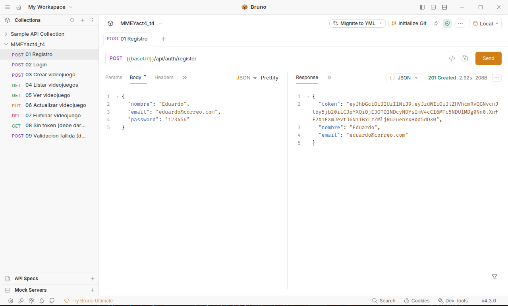

### Login
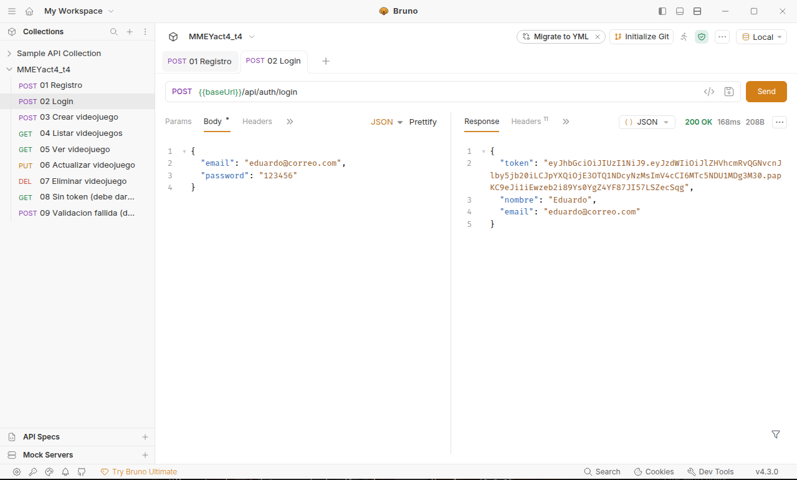

### Crear (POST)
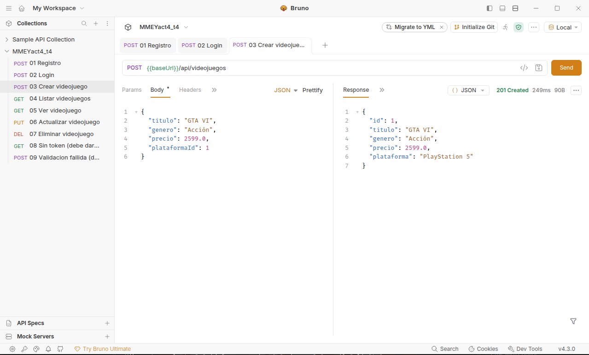

### Listar con paginación (GET)
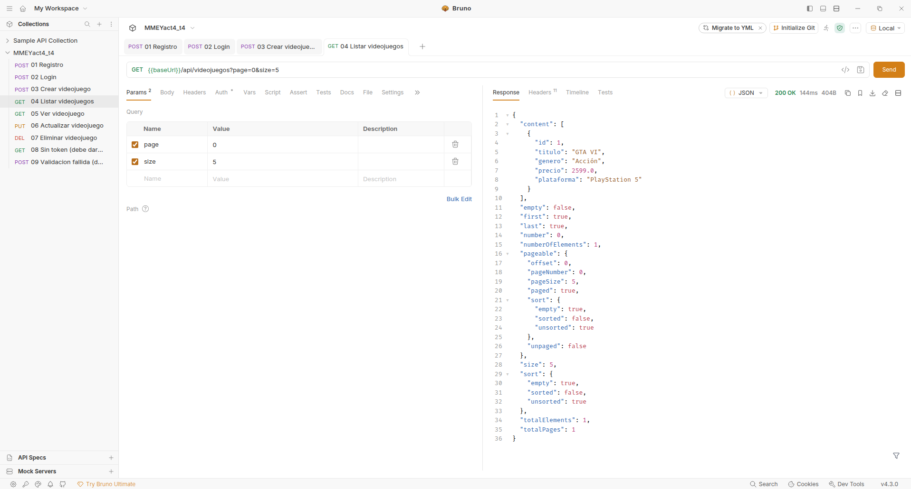

### Ver uno (GET)
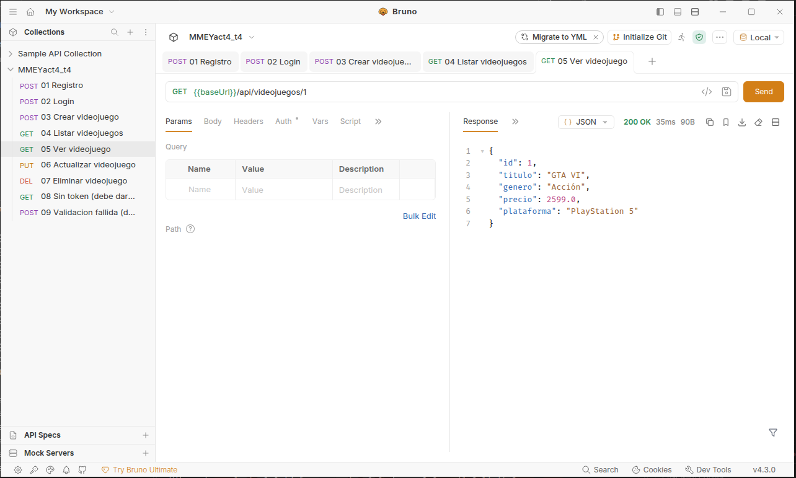

### Actualizar (PUT)
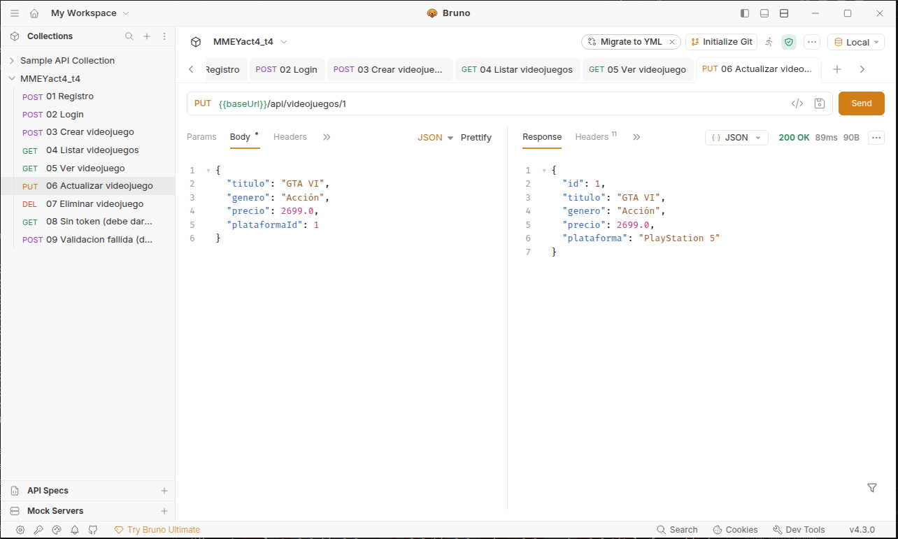

### Eliminar (DELETE)
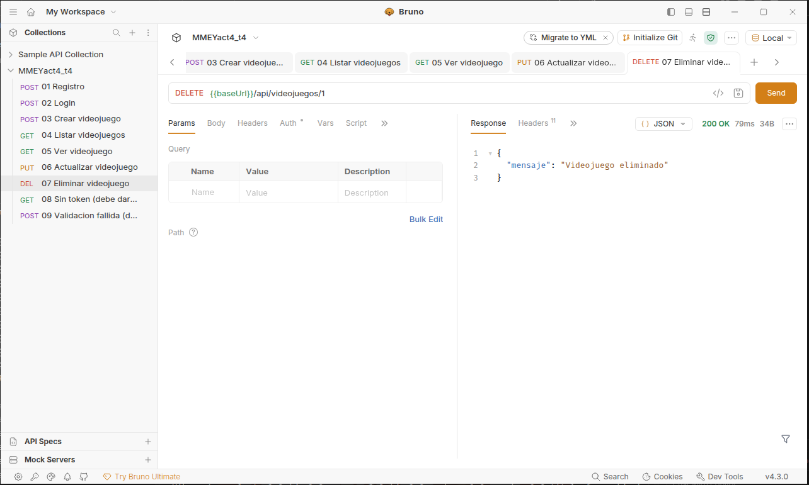

### Petición sin token (401)
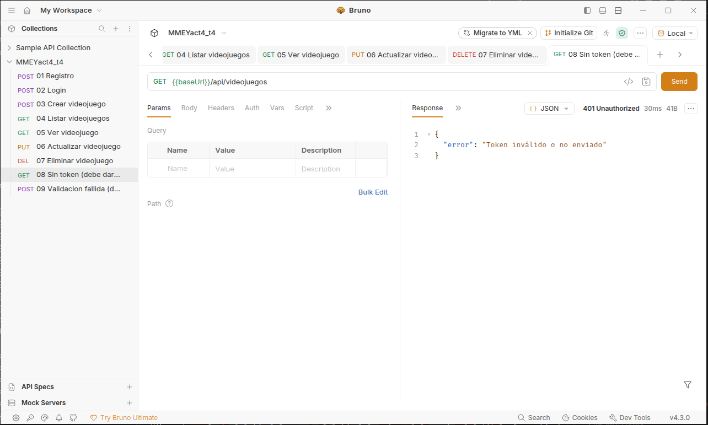

### Validación fallida (400)
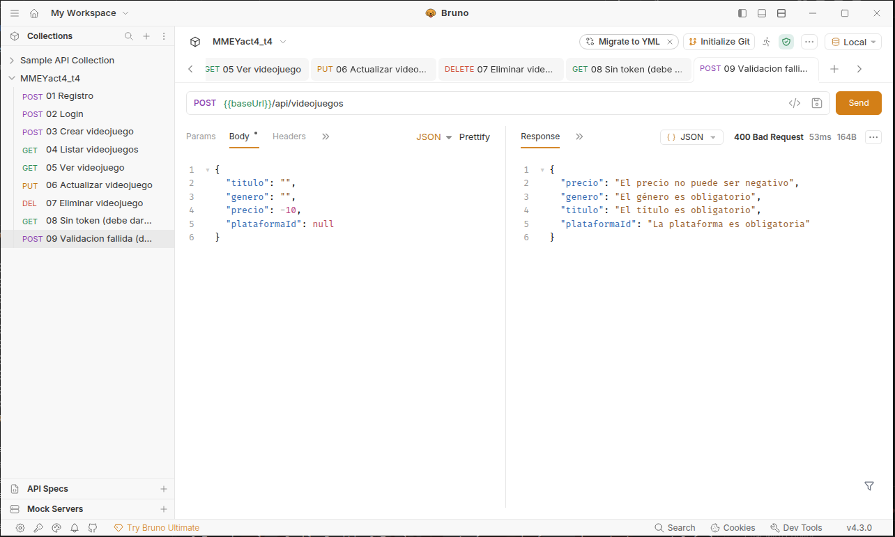

### Funcionando en el VPS (entorno "VPS" de Bruno)
Registro en el VPS:

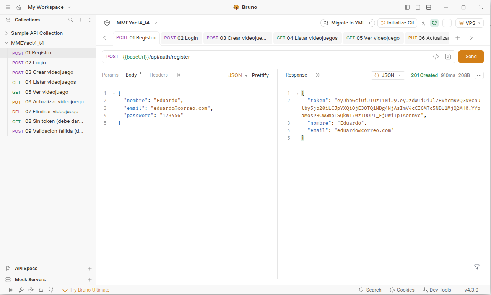

Crear videojuego en el VPS:

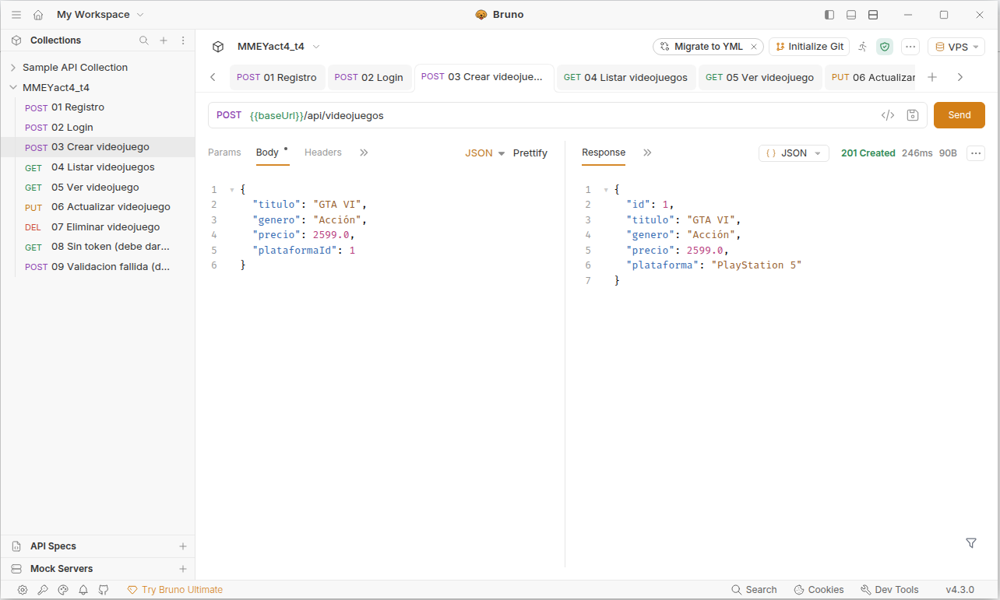

## Colección de Bruno
Está en la carpeta `bruno/`. Para usarla: abrir Bruno → Open Collection → elegir la carpeta `bruno` → seleccionar el entorno **Local** o **VPS**. El registro y el login guardan el token automáticamente en la variable `token`.

## Configuración
Las credenciales no están en el repositorio. En `application.properties` aparecen como `${DB_PASSWORD}` y `${JWT_SECRET}`:
- En local se leen de `secrets.properties` (en el `.gitignore`).
- En el VPS se pasan como variables de entorno.

Base de datos:

    CREATE DATABASE act4_t4;
    INSERT INTO plataforma (nombre) VALUES ('PlayStation 5'),('Xbox Series X'),('Nintendo Switch'),('PC');

## Fuentes consultadas
- Spring Security, arquitectura y filtros: https://docs.spring.io/spring-security/reference/servlet/architecture.html
- Spring Security, almacenamiento de contraseñas (BCrypt): https://docs.spring.io/spring-security/reference/features/authentication/password-storage.html
- jjwt (librería JWT): https://github.com/jwtk/jjwt
- Introducción a JWT: https://jwt.io/introduction
- Bean Validation en Spring: https://docs.spring.io/spring-framework/reference/core/validation/beanvalidation.html
- Manejo de errores con `@RestControllerAdvice`: https://docs.spring.io/spring-framework/reference/web/webmvc/mvc-controller/ann-advice.html
- Paginación con Spring Data: https://docs.spring.io/spring-data/jpa/reference/repositories/query-methods-details.html
- Bruno: https://docs.usebruno.com
